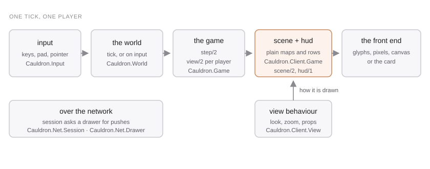

# Architecture

Cauldron is split so a game pays only for what it draws with. `cauldron_core` holds the
parts that never touch a picture. `cauldron_2d` and the 3D packages hold the drawing. Each
front end is its own package, and all of them take the same client module.

| Package | Owns | May depend on |
| --- | --- | --- |
| `cauldron_core` | Worlds, players, input, menus, the client contract, sound, saving, scores, ledger, networking | `tuning_fork`, `tuning_fork_speaker` |
| `cauldron_2d` | Tiles, atlases, pictures, drawing, projections, maps, grids, sectors, 2D bodies | `cauldron_core`, `linocut`, `french_curve` |
| `cauldron_2d_drafter`, `cauldron_2d_net`, `cauldron_2d_wx`, `cauldron_2d_native` | One front end each | `cauldron_2d`, the package the front end draws with |
| `cauldron_net` | Worlds across a socket, channels, links, remote views | `cauldron_core` |
| `cauldron_3d` | A software renderer and collision | nothing |
| `cauldron_3d_scene` | A 3D scene as data and the renderer protocol | optionally `cauldron_3d`, `cauldron_2d` |
| `cauldron_gpu` | Metal and Vulkan rendering of a scene | `cauldron_3d_scene` |
| `cauldron_3d_formats` | Quake, glTF and VRM readers | `cauldron_3d` |

One rule holds the table together: **`cauldron_core` never depends on a way of drawing.**
It names no atlas, pixel, projection or RGB. Where it needs one it calls a behaviour, and
the package that draws supplies the implementation. A game written for the terminal
therefore runs in a browser with neither its world nor its client module changing.

## The two modules of a game

A game is two modules. The world holds state and rules; the client says how that state
looks.

`Cauldron.Game` is the world behaviour: `init/1`, `join/3`, `leave/2`, `handle_input/3`,
`step/2`, `view/2`, `drain_events/1`, and optionally `export/1`, `restore/1`, `checksum/1`
and `input_delay/1`. Every callback is pure — no process, no clock, no drawing.
`Cauldron.World` owns the process and the clock and calls the module.

`Cauldron.Client.Game` is larger, because a front end needs everything from it:
`title/0`, `view/0`, `actions/0`, `keymaps/0`, `worlds/1`, `scene/1,2`, `hud/1`,
`sounds/0`, `music/0`, `cue/2`, `listener/1`, `toggles/0`, `holds/0`.

`Cauldron.Front` runs the screens a player walks through: title, lobby, settings, world,
summary, guide. It knows no front end. A terminal client, a browser client and a window
client give it the same client module and get the same screens.

## How a frame is made

Every front end takes the same path from a key press to a pixel.

1. **Input** arrives as actions, pressed or held. `Cauldron.Input` turns a keymap or a pad
   map into actions; `Cauldron.Presses` separates a press from a hold.
2. **The world ticks.** `Cauldron.World` calls `step/2` at the world's rate, or only on
   input when it was started with `tick: :on_input`. It then calls `view/2` once per
   player, so each player gets their own view.
3. **The view becomes a scene.** `scene/2` turns the view into the plain map a front end
   draws; `hud/1` turns it into rows of runs.
4. **The view behaviour** turns a look into drawing props: `look/1`, `props/4`, `zoom/1`,
   `turn/2`, `steered/2` and the rest. `cauldron_2d` implements it as
   `Cauldron2D.Client.View`.
5. **The front end draws.** A terminal draws glyphs or pixels, a browser a canvas, a
   window through wx. A scene that carries a `:gpu` function can go to the card instead.

## The network seam

`cauldron_net` carries a world to clients outside its VM. It does not know what a frame
looks like; the drawer does.

`Cauldron.Net.Drawer` is what a front end implements to put its frames on the wire:
`open/2`, `changed/3`, `pane/2`, `draw/2`, `world_at/3`, `close/2`, `colour/1`, `local/2`,
`reader/1`, `read/4`, `remote/2`, `browser/0`. `Cauldron2D.Net.Drawer` is the 2D one.
`Cauldron.Net.Session` names a drawer and asks it for pushes.

The split follows the rest of the family. Sessions, sockets, channels, links and the sound
policy are in `cauldron_net`; what a 2D frame is on the wire, the pages and the no-code
`Serve` are in `cauldron_2d_net`.

## The 3D seam

`Cauldron3D.Scene.Target` is a protocol rather than a behaviour: a scene is uploaded to
whatever implements it. `CauldronGPU` implements it on a card, `CauldronGPU.Host` in its
own process, `Cauldron3D.Net.Scene` in a browser, and `Cauldron3D.Scene.Software` on the
CPU where `cauldron_3d` is loaded.

Every converter — BSP, alias model, studio model, sectors — uploads through the protocol,
so one converter serves every renderer.

## Where state lives

| State | Owner | Lifetime |
| --- | --- | --- |
| A world's game state | the game module, inside `Cauldron.World` | one world |
| Which worlds exist | `Cauldron.Worlds` | the node |
| A player's seat, props and settings | `Cauldron.Player`, the front end's settings file | a session, then a file |
| The compiled atlas | `Cauldron2D.Atlas` and its tables | one node |
| Scores and the ledger | `Cauldron.Scores`, `Cauldron.Ledger` | a file |
| A save | `Cauldron.Save` | a file |

Nothing that draws keeps game state, and nothing that holds game state draws. That is why
a world tests without a process, and why it moves between front ends without a rewrite.

## Conventions the code keeps

- **Warnings are errors.** Every package sets
  `elixirc_options: [warnings_as_errors: true]`.
- **Public modules are documented.** A module with neither a `@moduledoc` nor
  `@moduledoc false` fails review.
- **Guides are for users.** A package guide explains how to use the package. The developer
  chapters are in this book, not in a package's HexDocs.
- **A package name matches its modules.** `cauldron_core` holds `Cauldron.*`,
  `cauldron_2d` holds `Cauldron2D.*`, and so on down the family.
