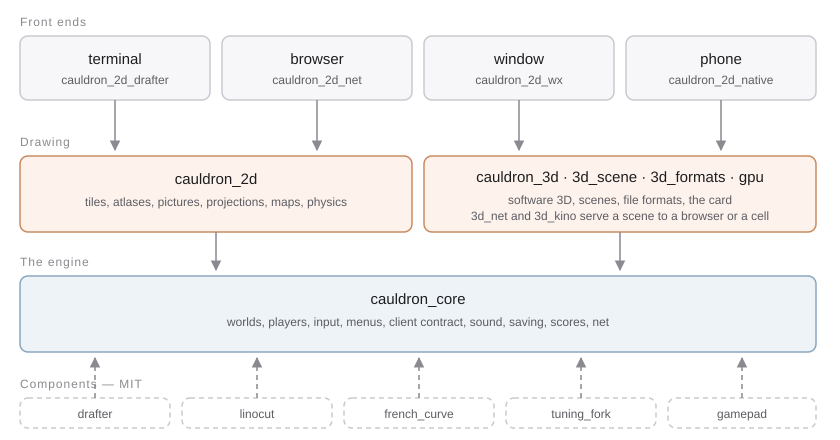

# Architecture

This chapter is for someone changing the engine rather than writing a game with it.
It describes what each package owns, how a frame is made, and which way dependencies
point. It does not describe how any of it came to be — only what is true now.

## The shape of the family

| Package | Owns | May depend on |
| --- | --- | --- |
| `cauldron_core` | Worlds, players, input, menus, the client contract, sound, saving, scores, ledger, networking | `tuning_fork`, `tuning_fork_speaker` |
| `cauldron_2d` | Tiles, atlases, pictures, drawing, projections, maps, grids, sectors, 2D bodies | `cauldron_core`, `linocut`, `french_curve` |
| `cauldron_2d_drafter`, `cauldron_2d_net`, `cauldron_2d_wx`, `cauldron_2d_native` | One front end each | `cauldron_2d`, the package the front end draws with |
| `cauldron_net` | Worlds across a socket, channels, links, remote views | `cauldron_core` |
| `cauldron_3d` | A software renderer and collision | nothing |
| `cauldron_3d_scene` | A 3D scene as data and the renderer protocol | optionally `cauldron_3d`, `cauldron_2d` |
| `cauldron_gpu` | Metal and Vulkan rendering of a scene | `cauldron_3d_scene` |
| `cauldron_3d_formats` | Quake, glTF and VRM readers | `cauldron_3d` |

The rule behind the table is one sentence: **`cauldron_core` never depends on a way of
drawing.** Nothing in it names an atlas, a pixel, a projection or a colour's RGB. When
core needs one of those it calls a behaviour the front end supplies, and the 2D package
supplies the 2D implementation.

This is why a game written against `cauldron_2d` can be served in a browser without
changing its world or client module, and why the 3D packages can exist without dragging
the tile engine in.

## The two modules of a game

A game is a world module implementing `Cauldron.Game` and a client module implementing
`Cauldron.Client.Game`. One is state, the other is presentation.

`Cauldron.Game` callbacks are `init/1`, `join/3`, `leave/2`, `handle_input/3`, `step/2`,
`view/2` and `drain_events/1`, with optional `export/1`, `restore/1`, `checksum/1` and
`input_delay/1`. Every callback is pure: the world holds no process, reads no clock and
draws nothing. `Cauldron.World` owns the process and the clock, and calls the module.

`Cauldron.Client.Game` is larger because it is where a front end learns everything it
needs: `title/0`, `view/0`, `actions/0`, `keymaps/0`, `worlds/1`, `scene/1,2`, `hud/1`,
`sounds/0`, `music/0`, `cue/2`, `listener/1`, `toggles/0`, `holds/0`.

`Cauldron.Front` runs the screens a player walks through. It is front-end independent:
a terminal client, a browser client and a window client each hand it the same client
module and get the same sequence of title, lobby, world and summary.

## How a frame is made

The path from a key press to a pixel is the same in every front end.

1. **Input** arrives as actions held or pressed. `Cauldron.Input` turns a keymap or a
   controller map into actions; `Cauldron.Presses` separates a press from a hold.
2. **The world ticks.** `Cauldron.World` calls `step/2` at the world's tick rate, or on
   input when it was started with `tick: :on_input`. It then calls `view/2` once per
   player, so each player sees their own view.
3. **The view becomes a scene.** `Cauldron.Client.Game.scene/2` turns the view into the
   plain-map scene the front end draws, and `hud/1` into rows of runs.
4. **The view behaviour** decides how the look is turned into drawing props:
   `Cauldron.Client.View.look/1`, `props/4`, `zoom/1`, `turn/2`, `steered/2` and the
   rest. `cauldron_2d` implements it as `Cauldron2D.Client.View`.
5. **The front end draws.** A terminal draws glyphs or pixels, a browser draws a canvas,
   a window draws through wx. A game whose scene carries a `:gpu` function can have the
   card draw it instead.

## The network seam

`cauldron_net` carries a world to clients that are not in the same VM. It does not know
what a frame looks like: that is the drawer's job.

`Cauldron.Net.Drawer` is the behaviour a front end implements to put its frames on the
wire: `open/2`, `changed/3`, `pane/2`, `draw/2`, `world_at/3`, `close/2`, `colour/1`,
`local/2`, `reader/1`, `read/4`, `remote/2`, `browser/0`. `Cauldron2D.Net.Drawer` is
the 2D implementation; `Cauldron.Net.Session` names it and asks it for pushes.

The packages split along the same line as the rest of the family: `cauldron_net` holds
sessions, sockets, channels, links and the sound policy; `cauldron_2d_net` holds what a
2D frame is on the wire, the pages and the no-code `Serve`.

## The 3D seam

`Cauldron3D.Scene.Target` is a protocol, not a behaviour: a scene is uploaded to
whatever implements it. `CauldronGPU` implements it with a card, `CauldronGPU.Host`
with a separate process, `Cauldron3D.Net.Scene` with a browser, and
`Cauldron3D.Scene.Software` with the CPU when `cauldron_3d` is present.

A converter — BSP, alias model, studio model, sectors — uploads meshes, textures,
materials and scatters through the protocol, so one converter serves every renderer.

## Where state lives

| State | Owner | Lifetime |
| --- | --- | --- |
| A world's game state | the game module, inside `Cauldron.World` | one world |
| Which worlds exist | `Cauldron.Worlds` | the node |
| A player's seat, props and settings | `Cauldron.Player`, the front end's settings file | a session, then a file |
| The compiled atlas | `Cauldron2D.Atlas` and its tables | one node |
| Scores and the ledger | `Cauldron.Scores`, `Cauldron.Ledger` | a file |
| A save | `Cauldron.Save` | a file |

Nothing that draws keeps game state, and nothing that holds game state draws. That is
what makes a world testable with no process and portable between front ends.

## Conventions the code keeps

- **Warnings are errors.** Every package sets `elixirc_options: [warnings_as_errors: true]`.
- **Public modules are documented.** A module without `@moduledoc` fails review;
  `@moduledoc false` is for internals only.
- **Guides are for users.** Package guides explain how to use a package. This chapter
  and the two after it are the only developer chapters; they live in the book, not in a
  package's HexDocs.
- **A package name matches its modules.** `cauldron_core` holds `Cauldron.*`,
  `cauldron_2d` holds `Cauldron2D.*`, and so on down the family.
