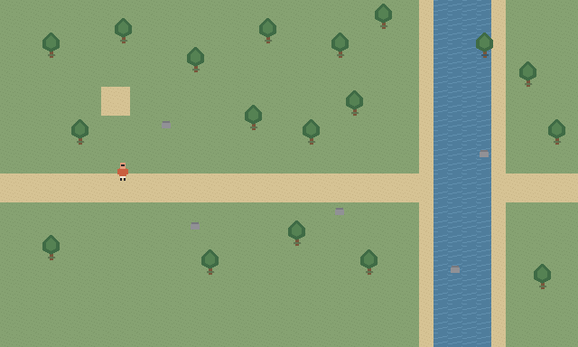
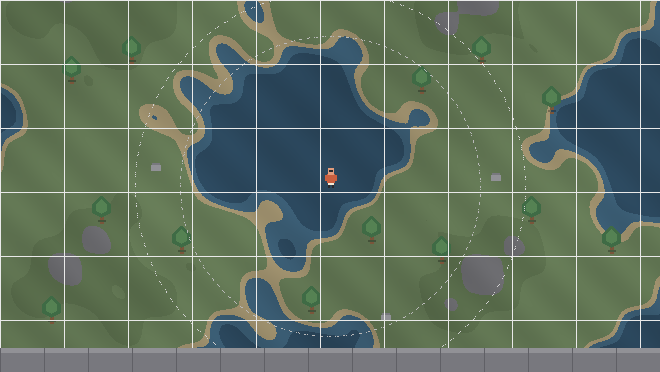
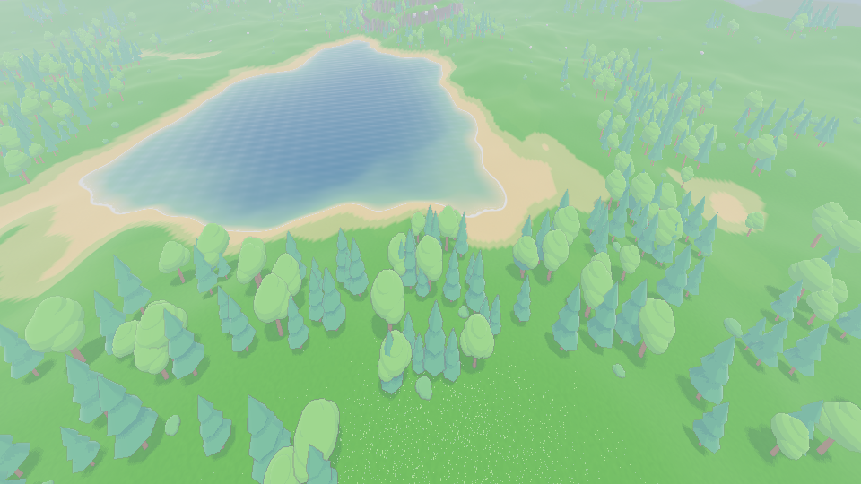

# From tiles to an open world

A game can start as a grid of tiles and end as a landscape with no edge. The world module,
the client module and the front end do not change on the way. What changes is how much of
the world the game describes.

The three pictures below are one camera on three games. Each was drawn by the engine from
data, not by an artist.

## 1. Tiles


The first version is a table of tile ids. Every tile is the same size, the map is as large
as the table, and a move goes from one square to the next.

It costs almost nothing. A screen holds a few hundred tiles, a tile is one index into an
atlas, and a whole level fits in memory and in a test. `Cauldron2D.Map` reads one from LDtk
or Tiled, `Cauldron2D.Atlas` holds the pictures, and the scene draws the tiles the camera
covers. Movement, collision and line of sight are grid lookups: `Cauldron2D.Grid` and
`Cauldron2D.Collision`.

Start here for a puzzle, a roguelike, or any game where the level is the design.

## 2. The same world with art



The second version keeps the grid and spends its effort on how the world looks and moves:
drawn art instead of flat colours, trees and rocks as pictures that overlap by depth,
shadows, water, a character with frames, a hud.

The map did not change. The scene did. `Cauldron2D.Picture` cuts frames out of an art file;
`Cauldron2D.Atlas.Manifest` derives one art from another by a line of text; the projections
choose the camera; `Cauldron2D.Draw` turns a view into the scene a front end draws.

Most 2D games live here. It is still a grid, still finite, still easy to test.

## 3. An open world



The open world drops the grid. The ground is a height field sampled inside square cells,
the map has no fixed size, and the part of it that exists at any moment is the part within
reach of a viewer.

`Cauldron.OpenWorld` is that world, in `cauldron_core`, with no drawing in it:

* **`Map`** — cells laid edge to edge, added and removed one at a time. It knows the height
  at a point and where a move ends.
* **`Cell`** — one square: ground heights, four kinds of ground, water, the things standing
  in it, and named marks.
* **`Thing`** — a tree, a rock, a signpost: its kind, where it stands, how tall it is, which
  way it faces, how far it blocks.
* **`Panel`** — a standing picture at the edge of what is simulated, so the country beyond
  can be seen and never reached.
* **`Edge`** — the behaviour that stops a mover where the simulation ends.
* **`Window`** — which cells to hold. `load` is what is wanted; `keep` is what is held until
  it is far enough away to drop.
* **`Mover`** — walking, climbing, jumping, swimming and falling over the ground.
* **`Store`** — where cells come from: memory, files, or the game's own generator.

```elixir
map =
  Cauldron.OpenWorld.Map.new(
    cell_size: 64.0,
    samples: 64,
    edges: [{Cauldron.OpenWorld.Edge.Scenery, margin: 1.0}]
  )

cell =
  Cauldron.OpenWorld.Cell.sampled(
    {0, 0},
    64,
    64.0,
    fn {x, y} -> 8.0 + 3.0 * :math.sin(x / 9.0) + 2.0 * :math.cos(y / 7.0) end,
    water: 6.0,
    things: [
      %Cauldron.OpenWorld.Thing{kind: :pine, position: {12.5, 40.0}, radius: 0.4}
    ]
  )

map = Cauldron.OpenWorld.Map.put(map, cell)
```

The window decides which cells to fetch and which to forget as the player moves:

```elixir
%{load: to_fetch, drop: to_forget, held: held} =
  Cauldron.OpenWorld.Window.step(held, map, [{130.0, 40.0}], load: 200.0, keep: 260.0)
```

The two dashed rings in the picture are `load` and `keep`. Past the simulated cells an edge
stops the mover, and a panel shows what lies beyond. The mover walks the ground rather than
a grid; `intent` is what the player holds — `%{toward: {x, y}, dash: boolean(), leap:
boolean()}` — and `pace` the speeds the game sets:

```elixir
mover = Cauldron.OpenWorld.Mover.new({12.5, 40.0}, map)
mover = Cauldron.OpenWorld.Mover.step(mover, map, intent, pace, seconds)

{endpoint, edges_that_stopped} =
  Cauldron.OpenWorld.Map.travel(map, mover.point, wanted)
```



That frame is `Vale`'s own scene — walker, land and light — read back without a window:
`CauldronGPU.open(window: false)` and `capture/2`. `book/make_vale_frame.exs` draws it
again.

A game takes up the open world without rewriting itself. The world module still implements
`Cauldron.Game`; `view/2` returns something else and the client's `scene/2` draws that
instead. `cauldron_examples/3d/vale` is a complete one: eight cells of 64 metres, six by six
simulated, a ring of country seen and never reached, four painted panels. Its map is one
module, `Vale.Land`.

## What to choose

| | Tiles | Tiles with art | Open world |
| --- | --- | --- | --- |
| The level is | a table of ids | a table of ids | generated or stored cells |
| Size | what fits in memory | what fits in memory | as far as a viewer walks |
| Movement | square to square | square to square, or free on the grid | over ground heights |
| Cost | a screen of tiles | an atlas and a scene | a store, a window and a mover |
| Good for | puzzles, roguelikes | most 2D games | exploring, landscapes, 3D |

The step from one to the next is a change of data, not of contract. That is the point of a
pure world module: the game can grow a landscape and no front end has to learn about it.
