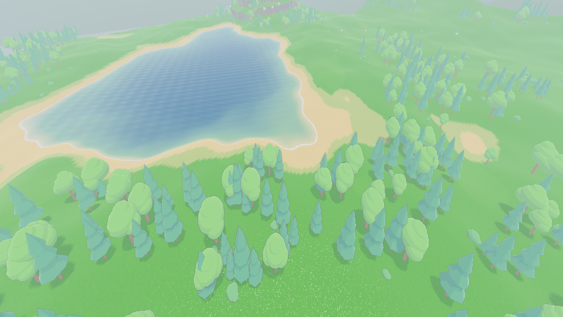

<div class="cover">

<div class="cover-panel">
<h1 class="cover-title">Cauldron</h1>
<p class="cover-sub">A BEAM-powered game engine.</p>
</div>
</div>

<div class="blurb">


# Cauldron

Cauldron is a game engine for the BEAM, written in Elixir.

A game is two modules. The world module is pure state and pure rules: it holds the game,
takes a tick, and answers with a view. The client module says what that view looks like —
the pictures, the keys, the menus, the sound — and every front end reads it. Because the
world is pure, a test runs a game with no process and no clock, and the same game runs in
a terminal, in a browser, in a desktop window and on a phone without being rewritten.

A game can begin as a grid of tiles, gather an atlas of art, and end as an open world of
cells streamed around the player. The contract between the game and the engine does not
change along the way.

Part one is for making a game: worlds and players, input, sound, saving, testing, the 2D
engine and every front end, and a chapter that follows one game from tiles to an open
world. Part two is for working on the engine: how a frame is made, what a new front end
or renderer implements, and the rules a change is held to.

## How to read this book

The book has two parts.

**Part one — Using Cauldron** is for someone writing a game. Start at the introduction,
add the packages with the installation chapter, then read the chapter for the thing you
want to do. The chapters are the same guides that ship with each package, in the order a
game is built: the world and its players, input, sound, saving and testing, then the 2D
engine, then the front ends, then 3D and the smaller tools.

**Part two — Working on Cauldron** is for someone changing the engine. It explains the
package boundaries, how a frame is made, the behaviours a new front end or renderer
implements, and the commands and rules a change is held to.

If you are new to the engine, read part one in order. If you are looking for one
answer, the glossary and the troubleshooting chapter are at the end of part one.

## What is in the box

| Package | What it is for |
| --- | --- |
| `cauldron_core` | Worlds, players, input, menus, sound, saving, scores, the client contract |
| `cauldron_2d` | Tiles, atlases, pictures, 2D drawing, projections, maps, physics |
| `cauldron_2d_drafter` | A game in a terminal, and served over SSH or telnet |
| `cauldron_2d_net` | A game in a browser |
| `cauldron_2d_wx` | A game in a desktop window |
| `cauldron_2d_native` | A game on a phone or tablet |
| `cauldron_3d`, `cauldron_3d_scene`, `cauldron_3d_formats` | 3D rendering, scenes and file formats |
| `cauldron_gpu` | The graphics card |
| `cauldron_3d_net`, `cauldron_3d_kino` | 3D in a browser or a Livebook cell |
| `cauldron_net` | Worlds across the network |
| `cauldron_native` | iOS and Android hosts, and native controls |
| `cauldron_sfx` | A sound-effect bank and its editors |
| `cauldron_2d_easel` | Art editing as data, in a terminal, a browser or Livebook |

The `cauldron_*` packages are free software under the GNU Affero General Public
License, version 3. A game or service whose source you do not publish needs a commercial
license; see `COMMERCIAL.md` in the repository. The components they are built with —
`linocut` and `quake_c`, and `drafter`, `french_curve`, `tuning_fork` and `gamepad` in
their own repositories — are MIT.

## Building this book

```sh
elixir book/build.exs          # book/build/cauldron.md, .html and .pdf
```

The figures are drawn by the engine itself: `book/make_figures.exs` writes the tile
world, and the diagrams are SVGs beside it in `book/assets/`.
