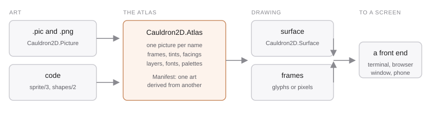
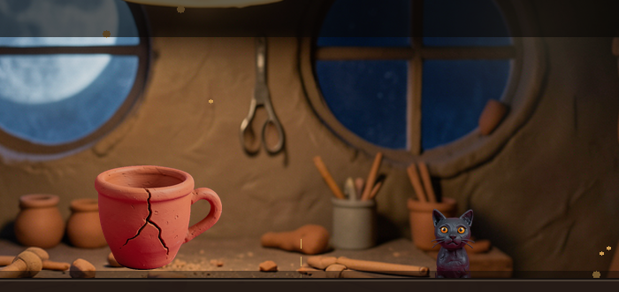

# Art: atlases, pictures and fonts

A Cauldron2D game draws from an atlas: a named catalogue of tiles. Each tile has a
picture, or a run of frames, and a glyph and a colour for terminals that draw characters.
Art is data. The renderer takes an atlas and a scene and asks for nothing else.






The pages after this take the atlas into a world ([Projections](projections.html)) and
build one for a whole game ([the tutorial](tutorial.html)).

## What an atlas holds

`Cauldron2D.Atlas.new/2` starts an empty one. It needs a name and a tile size. The void
colour fills a cell with nothing in it.

```elixir
alias Cauldron2D.{Atlas, Raster, Shapes}

flame =
  Raster.new(16, 16)
  |> Shapes.fill_circle({8, 10}, 5, {255, 120, 20, 255})
  |> Shapes.fill_circle({8, 12}, 3, {255, 220, 120, 255})

hero = Cauldron2D.Picture.sprite(".HH.\nHWWH\n.HH.\n.DD.", H: "#e8d8a8", W: "#203040", D: "#6a4a2a")

atlas =
  Atlas.new(:dungeon, tile: 16, void: {8, 8, 12})
  |> Atlas.put(:floor, Raster.new(16, 16, background: {42, 46, 60, 255}),
    glyph: "· ", color: {70, 76, 96}
  )
  |> Atlas.put(:torch, [flame, Shapes.fill_circle(flame, {8, 11}, 2, {255, 240, 180, 255})],
    glyph: "i ", color: {255, 140, 40}, fps: 10
  )
  |> Atlas.put(:hero, hero, glyph: "@ ", color: {240, 230, 200}, stand: 0.4)
  |> Atlas.tint(:dim, fn {r, g, b, a} -> {div(r, 3), div(g, 3), div(b, 3), a} end)
  |> Atlas.install()
```

An entry is more than a sprite:

| field | what it is |
| --- | --- |
| `:sprite` | the first frame, what every reader without a time draws |
| `:frames`, `:fps` | the run of frames and how fast it loops (`frame_at/3`, `frame_index/3`) |
| `:glyph`, `:color` | what a text renderer draws instead of the picture |
| `:size` | the picture's `{width, height}` in pixels |
| `:height` | how many storeys the art stands: a block in the isometric and first-person views |
| `:faces` | `:top`, `:side` and the compass sides a standing art shows |
| `:poses` | `:front`, `:back` and `:side` pictures for a mover that faces a camera |
| `:stand` | how tall the art stands in tiles when drawn as a billboard |
| `:eye` | how far above the ground it looks from, when the camera is put where it stands |

Rules a caller has to keep: every base tile of one atlas is the atlas's tile size, as is
every face. An overlay or a mover may be any size, all its frames alike, and stands on
its tile; that is how a sprite taller than its tile is stored, and it can never be a
cell's base. `Atlas.put/4` raises on frames that disagree in size, on an empty frame
list, and on a face that is not a tile. `Atlas.put/4` takes `:glyph` (two columns wide),
`:color`, `:fps`, `:height`, `:faces`, `:poses`, `:stand` and `:eye`; the defaults are
the glyph `"??"`, the colour `{255, 0, 255}`, 8 frames a second and nothing standing.

A tint is a named function over an RGBA tuple. `Atlas.tint/3` registers one; it is
applied when a tile is composited, and the result is cached under the tint's name. A
scene names a tint as a cell's third element, or a mover's `%{tint: name}`.

`Atlas.install/1` publishes the atlas under its name and creates the ETS table
`Atlas.cache/1` names. It must run before any renderer refers to the atlas by name.
Installing the same atlas again keeps the composited tiles; installing a different one
empties the cache and tells every subscriber. `Atlas.subscribe/1` delivers
`{:cauldron_atlas, name, :changed}` to the calling process, which is how an editor's save
reaches a running game. `Atlas.installed?/1` answers whether anything is installed under
a name.

`Atlas.fetch/1` accepts a name or a struct; `Atlas.entry/2`, `arts/1`, `animated?/2`,
`face/3`, `pose/4`, `standing/2`, `eye_height/2` and `tallest/1` read an installed one.

## From a directory

A directory of pictures is the shortest way to an atlas.

```elixir
{:ok, atlas} =
  Atlas.load(:dungeon, "priv/art",
    tile: 16,
    void: {8, 8, 12},
    arts: [torch: [glyph: "i ", color: {255, 140, 40}, fps: 10]]
  )

Atlas.install(atlas)
:ok = Atlas.subscribe(:dungeon)
```

`Atlas.load/3` reads every `.png` and `.pic` in the directory, each art named by its
file. A `.pic` gives its frames as it draws them, at their own size; one smaller than a
tile is centred in one. A `.png` exactly one tile square is the art. One a whole number
of tiles wide and one tile tall is a strip of frames, left to right. Any other size is
one art of that size. A file that will not read is `{:error, {:art, file, reason}}`.

`:arts` lays over the `atlas.txt` manifest, per art: `glyph:`, `color:`, `fps:` and
`frame: {width, height}`, which cuts a picture into frames of that size, left to right
and top to bottom, whatever the tile. `:fps` is the rate of every strip not given one.
`:fonts` cuts pixel fonts from pictures in the same directory; see below.

An art the manifest derives from another is built after the pictures. One that cannot be
made is `{:error, {:art, name, message}}`.

## `.pic` files

A `.pic` is a palette, a blank line and the picture, one character a pixel. `.` and space
are transparent. This is a small gem:

```
O #2a160c
D #7a3418
C #b5562c
L #d9804a

..OOOO..
.ODLLDO.
ODLLLLDO
.ODLLDO.
..OOOO..
```

A palette colour may carry alpha, `#9fd8ff70`. A line holding `---` separates frames, so
the same file can hold a torch's flicker. `Cauldron2D.Picture.pic/2` reads the same text
from a string; `Picture.load/2` reads a `.pic` or a `.png` from a path. A picture smaller
than a tile is centred in one by `Atlas.load/3`, the background left transparent.

## Pictures in code

`Cauldron2D.Picture` is the pure layer under the atlas. Every function that draws
returns a `Cauldron2D.Raster`; one that reads text or bytes answers `{:ok, raster}`.

| you want | call |
| --- | --- |
| a sprite as text and a palette | `Cauldron2D.Picture.sprite/3` |
| a `.pic` in a string, or a file | `Cauldron2D.Picture.pic/2`, `load/2` |
| a shape from an outline | `Cauldron2D.Picture.outline/2` |
| the shape at every heading | `Cauldron2D.Picture.headings/3` |
| mirror, turn, enlarge, squeeze | `flip/2`, `rotate/2`, `scale/2`, `squash/3` |
| mix a colour, replace colours | `Cauldron2D.Picture.tint/3`, `recolour/2` |
| cut into frames | `Cauldron2D.Picture.frames/2` |
| move every pixel by a function | `Cauldron2D.Picture.transform/3` |
| PNG bytes decoded | `Cauldron2D.Picture.decode_png/1` |

A sprite as text is the quickest art there is:

```elixir
ship = Cauldron2D.Picture.sprite("..RR..\n.RWWR.\nRRWWRR\n..RR..", R: "#c33", W: :white)
```

An outline is a list of `{x, y}` points, `y` upward, closed from the last point back to
the first. Heading 0 is the shape as written, pointing right; headings turn
counter-clockwise on screen. `Picture.outline/2` needs `:size`; `:fill`, `:stroke`,
`:scale` and `:rotate` are optional. `Picture.headings/3` returns the shape at `count`
headings:

```elixir
points = [{15, 0}, {-8, 8}, {-8, -8}]

frames =
  Cauldron2D.Picture.headings(points, 64,
    size: {16, 16},
    fill: {200, 80, 60, 255}
  )

atlas =
  frames
  |> Enum.with_index()
  |> Enum.reduce(atlas, fn {frame, index}, acc ->
    Cauldron2D.Atlas.put(acc, :"ship_#{index}", frame, glyph: ">>", color: {200, 80, 60})
  end)
```

`Picture.frames/2` cuts a strip into frames `{width, height}` pixels each, left to right
then top to bottom, and leaves out a remainder narrower or shorter than a frame.
`Picture.squash/3` scales a picture on each axis and places it back in a canvas of the
original size, with `:anchor` (`:centre` or `:bottom`) and `:lean`; it is what turns one
standing picture into a lean, a crouch or a squash.

`Cauldron2D.Picture` uses `Cauldron2D.Palette`'s names, `#rgb`, `#rrggbb` and
`#rrggbbaa`, and `{r, g, b}` or `{r, g, b, a}` tuples interchangeably wherever a colour
is asked for.

## Shapes

`Cauldron2D.Shapes` draws lines, rectangles, circles and polygons onto a raster. Every
function takes the raster first and returns a new one. Coordinates are integer pixels,
`{0, 0}` at the top left, and may fall outside the raster: the part inside is drawn and
the rest clipped. Colours are `{r, g, b, a}` written opaquely, with no blending against
what is already there.

| call | draws |
| --- | --- |
| `Cauldron2D.Shapes.line/4`, `line_points/2` | a one-pixel line, both ends included |
| `Cauldron2D.Shapes.polyline/3` | segments through the points, not closed |
| `Cauldron2D.Shapes.rect/4`, `fill_rect/4` | a rectangle's edges, or every pixel of it |
| `Cauldron2D.Shapes.circle/4`, `fill_circle/4` | a circle outline, or a disc |
| `Cauldron2D.Shapes.fill_polygon/3` | a filled polygon, edges included |
| `Cauldron2D.Shapes.fill_columns/3` | vertical columns `{x, y_from, y_to}` |

Outlines are one batch of pixels and fills one batch of horizontal spans, so a call
costs one raster update however many pixels it covers.

```elixir
gem =
  Cauldron2D.Raster.new(16, 16)
  |> Cauldron2D.Shapes.fill_polygon([{8, 1}, {15, 8}, {8, 15}, {1, 8}], {80, 200, 220, 255})
  |> Cauldron2D.Shapes.line({8, 1}, {8, 15}, {200, 245, 255, 255})
```

## A picture's pixels

`Cauldron2D.Raster` is the value every drawing and backend function works on: a width, a
height, and a background colour for any pixel never written. Its contents sit in two
layers — a dense RGBA base buffer and a sparse map of written pixels over it. `get_pixel/3`
reads the top layer first. `finalize/1` folds the sparse writes into the dense buffer, so
a raster sent to a backend more than once does not rebuild it each time. Drawing after it
stays correct.

| call | does |
| --- | --- |
| `Cauldron2D.Raster.new/3` | an empty raster, `:background` optional |
| `Cauldron2D.Raster.put_pixel/4`, `put_pixels/3` | one pixel, or many in one merge |
| `Cauldron2D.Raster.get_pixel/3` | one pixel, or the background outside the raster |
| `Cauldron2D.Raster.fill_spans/3` | horizontal runs straight into the base buffer |
| `Cauldron2D.Raster.crop/3`, `rows/1` | a rectangle, or every pixel as rows of colours |
| `Cauldron2D.Raster.to_rgba_binary/1` | the dense RGBA bytes |
| `Cauldron2D.Raster.from_rgba/4` | a raster from dense bytes, without copying |

There is no alpha blending in `put_pixel/4`: the colour replaces. Compositing is
`Cauldron2D.Blend`'s job, and `Cauldron2D.Surface`'s for a scene.

## Fonts

A pixel font is a picture cut into cells, one character a cell, read left to right and
top to bottom. `Cauldron2D.Font.from_sheet/4` takes the sheet, the cell size and the
characters:

```elixir
{:ok, sheet} = Cauldron2D.Picture.load("priv/art/font.png")

alphabet = " !\"#$%&'()*+,-./0123456789:;<=>?@ABCDEFGHIJKLMNOPQRSTUVWXYZ"
font = Cauldron2D.Font.from_sheet(sheet, {8, 10}, alphabet)

Cauldron2D.Font.width(font, "SCORE 120")
Cauldron2D.Font.layout(font, "PRESS START\nTO PLAY", align: :centre)
Cauldron2D.Font.render(font, "GAME OVER", colour: {255, 220, 0, 255}, shadow: {0, 0, 0, 255})
```

`fixed: true` keeps every glyph cell. Otherwise the font trims each glyph's empty
right-hand columns, so its spacing is proportional. `:spacing`, `:space`, `:line`,
`:fallback` and `:upcase` fill in the rest. They set the spacing between glyphs, the
advance of a glyph with no pixels, and the distance from one line's top to the next. They
also say which character stands in for one the font lacks, and whether lowercase letters
the font lacks are drawn as capitals. Characters are graphemes; `"\n"` breaks a line.

`Font.height/2` is how tall a string is, and `Font.width/2` how wide its widest line is.
`Font.layout/3` says where each glyph goes, with `:align` and `:wrap` (a width in pixels
at which lines break between words). `Font.render/3` draws a string onto a raster big
enough for it, with `:colour`, `:shadow` and `:outline`, and `Font.silhouette/1` turns
every glyph pixel white while keeping its alpha.

`Atlas.load/3`'s `:fonts` option cuts fonts from the same directory:

```elixir
Atlas.load(:dungeon, "priv/art",
  tile: 16,
  fonts: [small: [file: "font.png", cell: {8, 10}, chars: alphabet]]
)
```

`Atlas.put_font/3` adds one built in code. `Atlas.font!/2` fetches a font from an atlas,
and `Atlas.white_font!/2` the version drawn in a colour. A scene's `:screen` items
(`Cauldron2D.Screen`) use these fonts for text fixed to the pane — a hud, a menu, a
title.

`Cauldron2D.Palette.names/0` lists the colour names every 2D front end understands, and
`Cauldron2D.Palette.rgb/1` gives one as `{r, g, b}`. Picture palettes take these names,
and so does a hud, through `Cauldron.Client.Hud.colour/2`.

## The manifest

`atlas.txt` beside the pictures gives each art what the picture cannot say. One art a
line, tab-separated:

| field | example | meaning |
| --- | --- | --- |
| name, glyph | `wall`, `# ` | the art's name and file name; two columns for a text renderer |
| colour | `#5a7cf0` | the glyph's colour |
| fps | `12` | frames a second |
| derivation | `from flame; colour F #3070ff` | how to make this art from another |
| height | `2` | storeys tall |
| faces | `top=roof side=wall south=door` | pictures for the top and the sides |
| poses | `front=hero_front back=hero_back side=hero_side` | pictures for each way it faces |
| stand | `0.75` | how tall it stands in tiles as a billboard |

An empty field leaves that setting to the picture:

```
wall	# 	#5a7cf0
flame	f 	#ff7000	12
flame_blue	f 	#3070ff	12	from flame; colour F #3070ff
house	# 	#a08060			2	top=roof side=wall south=door
hero	@ 						front=hero_front back=hero_back side=hero_side	0.75
```

`Cauldron2D.Atlas.Manifest.read/1` reads the file in a directory, empty when there is
none; `parse/1` reads the text; `derived/1` lists the derived arts in name order;
`arts/2` merges the manifest with a caller's `:arts` and lets the caller win;
`write/2` and `render/1` go the other way. `Manifest.file_name/0` is `"atlas.txt"`.

### Derived arts

A derivation is a short line of operations over the text of a `.pic` — keys, not pixels —
so one drawing gives many views:

| operation | does |
| --- | --- |
| `from NAME` | the picture to start from; always first |
| `colour KEY COLOUR` | change what one palette key means |
| `swap KEY KEY` | exchange what two keys mean |
| `flip h` / `flip v` | mirror left to right, or top to bottom |
| `turn 90` / `180` / `270` | clockwise, a quarter turn at a time |
| `shift DX DY` | move the picture; what leaves the edge is lost |
| `scale N` | `N` times as wide and tall, every key repeated |
| `frame N` | keep the `N`th frame alone, counting from 1 |
| `reverse` | the frames in the other order |
| `over NAME [DX DY]` | lay `NAME`'s first frame on every frame, moved by `DX DY` |

```txt
from knight; colour C #c02020; flip h
from walk; frame 2; over hat 0 -2
```

The `from` picture is a `.pic` in the directory or another derived art. `over` merges the
palettes, and refuses a key the two pictures use for different colours. A derivation that
leads back to itself is an error, and so is one that starts from nothing.

A manifest line may also name an art the directory has no file for, when a face or a pose
gives the picture; `Atlas.load/3` builds it from those.

## Where next

- [Projections](projections.html): the five ways the atlas becomes a world, and what art
  each one needs.
- [Maps and grids](maps-and-grids.html): the tiles an atlas is drawn into.
- [Physics](physics.html): what moves over them.
- [Your first game](tutorial.html): the whole path, art included.
