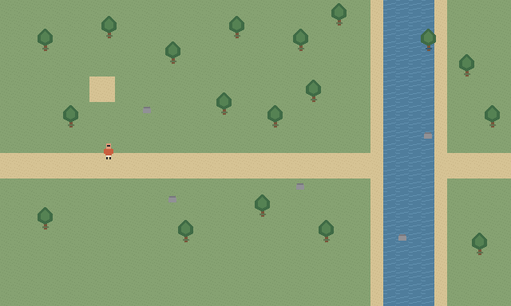

# Your first game: Cistern

This guide builds a small game from nothing and puts it in a terminal, in a browser and
in a window, with sound, more players and a computer opponent along the way. The whole
of it is in [`cauldron_examples/games/cistern`](https://github.com/jaman/cauldron/tree/main/cauldron_examples/games/cistern)
in the repository, tests included, so you can read the finished thing beside each step.

The game: **a town is in drought, and a storm has come — the Squall, a cloud with a
face, that will rain anywhere but the cistern.** You are the keeper, carrying three
clay jars: one balanced on your head, one hanging from each end of a yoke. The Squall
drifts along the top and lets the rain go. Every drop casts a ring on the ground where
it will land, so you walk under it and catch it. A drop that reaches the ground breaks
the jar hanging on that side, and the storm steps back to give you a breather. Catch
fifteen in a row and a broken jar is mended. When a storm's rain is all down, the next
storm is faster. When the last jar breaks, you are out.

It is a catching game in the line of Activision's *Kaboom!*: a villain with a face, a
pace that climbs, and a miss that costs you. A miss slows the game down rather than
ending it.

By the end you will have used:

| step | what you use |
|---|---|
| the game as a value | `Cauldron.Game`, `Cauldron.Rng`, `Cauldron.Tuning` |
| testing it | plain functions, `Cauldron.Test` |
| the art | `.pic` files, `atlas.txt`, `Cauldron2D.Atlas`, derived pictures |
| on screen | `Cauldron.Client.Game`, `Cauldron2D.Drafter.Client` |
| sound | `Cauldron.Audio`, `Cauldron.Audio.Music` |
| more players | `Cauldron.Worlds`, `Cauldron.Robot`, `Cauldron.World` |
| a browser | `Cauldron.Net.Socket`, `Cauldron.Net.Channel`, `Cauldron2D.Net.Pages` |
| a window | `Cauldron2D.Wx.Client` |
| replays and numbers | `Cauldron.Replay`, `Cauldron.Tuning`, `mix cauldron.report` |

## 0. A project

```
mix new cistern
```

Add the engine, the terminal front end and the art loader; the browser and the window
come later:

```elixir
defp deps do
  [
    {:cauldron_2d, "~> 0.4"},
    {:cauldron_2d_drafter, "~> 0.4"},
    {:linocut, "~> 0.3"},
    {:tuning_fork_speaker, "~> 0.1"}
  ]
end
```

`tuning_fork_speaker` is what makes sound come out of this machine; without it the game
runs silent.

## 1. The game as a value

A Cauldron game is a value and a handful of pure functions over it. Nothing in it reads a
clock, draws or plays a sound. The engine calls these functions; the game answers.

The behaviour is seven callbacks:

- `init/1` builds the starting state from options.
- `join/3` seats a player; `leave/2` removes one.
- `handle_input/3` is told what a player is holding — a set of actions, and where they
  point.
- `step/2` moves the world by `dt` seconds.
- `view/2` is what one player sees.
- `drain_events/1` is what happened since it was last asked.

Cistern splits the work over four small modules, each with one job:

| module | what it is |
|---|---|
| `Cistern.Game` | the `Cauldron.Game`: every keeper's square, players coming and going |
| `Cistern.Field` | one keeper's square and its rules: the rain, the jars, catches and misses |
| `Cistern.Squall` | the cloud: where it drifts, when it turns, its mood |
| `Cistern.Storm` | the pace of a storm: how fast and how much rain |

### The state

```elixir
defstruct fields: %{}, seed: 0, tuning: nil, seats: 0, events: []
```

A square per keeper, keyed by their id; the seed every square's rain comes from; the
numbers the game plays by; how many keepers have sat down; the events waiting to be
drained. A square is a `Cistern.Field`:

```elixir
defstruct [:id, :name, :rng, robot?: false, offset: 0, centre: 8.0,
           sides: MapSet.new([:left, :right]), held: MapSet.new(), aim: nil,
           squall: nil, drops: [], splashes: [], pops: [], level: 1, released: 0,
           until_drop: 0.0, lull: 0.0, caught: 0, score: 0, streak: 0, best: 1, out?: false]
```

Where the keeper stands, and which side jars they still carry; the head jar is always
there until they are out. The Squall, the drops in the air, the splashes and the `+3`s
still showing. Which storm it is, how much of its rain has fallen, the quiet before the
next drop, and the score.

### Starting

```elixir
@impl true
def init(opts) do
  seed =
    case Keyword.get(opts, :seed) do
      nil -> Rng.random() |> elem(1)
      seed -> seed
    end

  %__MODULE__{seed: seed, tuning: Settings.new(Keyword.get(opts, :tuning, []))}
end
```

The random generator lives *in the state*: each square holds a `Cauldron.Rng`, and
every call gives back `{value, next_rng}` for the square to keep. That is what makes a
game with the same seed play the same rain every time, and what makes replays and tests
possible.

The numbers live in a `Cauldron.Tuning`. `Cistern.Tuning` declares them once, with
defaults, limits and a line of documentation each:

```elixir
@spec_list [
  squall_speed: [default: 3.0, limits: {0.5, 20.0}, doc: "tiles a second the Squall drifts"],
  squall_speed_step: [default: 1.1, limits: {0.0, 5.0}, doc: "more each storm"],
  drop_every: [default: 1.1, limits: {0.15, 4.0}, doc: "seconds between drops"],
  ...
  streak: [default: 15, limits: {1, 100}, doc: "catches in a row that mend a jar"]
]

def new(overrides \\ []), do: Tuning.new(@spec_list, overrides)
```

`Cistern.Storm.pace/2` turns them into the pace of a storm: each pace setting is its
first-storm value moved by its step once for every storm after the first.

### Players

```elixir
@impl true
def join(%__MODULE__{} = game, id, props) do
  field =
    Field.new(id, Map.get(props, :username, "keeper"), game.seed,
      robot?: Map.get(props, :robot?, false),
      offset: game.seats * @apart,
      lull: Tuning.get(game.tuning, :lull)
    )

  {:ok, %{game | fields: Map.put(game.fields, id, field), seats: game.seats + 1}}
end
```

Every keeper gets a square of their own, rained on from the same seed. Two keepers
start out facing the same storm, and no two of them ever stand in each other's way.
`offset` places each square a hundred tiles from the last in the world; step 6 says why.

`props` are whatever the front end passes at the join; every Cauldron client passes
`:username`. A game that wants teams or a character choice names its own props and reads
them here.

### Input

```elixir
@impl true
def handle_input(%__MODULE__{} = game, id, %{held: held} = input) do
  case Map.fetch(game.fields, id) do
    {:ok, field} ->
      %{game | fields: Map.put(game.fields, id, Field.hold(field, held, Map.get(input, :aim)))}

    :error ->
      game
  end
end
```

Input is not keys. It is a `MapSet` of the **actions** the player is holding — `:left`,
`:right` — and an `aim`, the tile the pointer is over, if the front end has one. Which key
means which action is settled elsewhere (step 4), and the same game reads a keyboard, a
mouse and a browser touch the same way. `handle_input/3` is called only when a player's
input changed; `step/2` sees what they hold every tick.

### Stepping

`Cistern.Game.step/2` steps every square; a square's step is a pipeline of the things
that happen to it in a tick:

```elixir
def step(%__MODULE__{} = field, dt, tuning) do
  pace = Storm.pace(tuning, field.level)

  {field, []}
  |> walk(dt, Tuning.get(tuning, :keeper_speed))
  |> drift(dt, pace)
  |> release(dt, pace)
  |> fall(dt, pace, tuning)
  |> next_storm(tuning)
  |> then(fn {moved, events} -> {age(moved, dt), Enum.reverse(events)} end)
end
```

The keeper walks towards the pointer if there is an aim, else by the key held. The
Squall drifts towards a column it picked and, there, picks another; now and then it
turns early, more often the wilder the storm. After the lull, it lets a drop go every
`drop_every` seconds until the storm's rain is spent. The drops fall; each jar has a
mouth, a band of heights where a drop over it is caught, so the head jar catches higher
than the side jars:

```elixir
defp catching(jars, drop) do
  Enum.find(jars, fn jar ->
    drop.x >= jar.x and drop.x < jar.x + 1 and drop.y >= jar.from and drop.y < jar.until
  end)
end
```

A drop that gets to the ground is a miss. It breaks the jar on its side — or the other
side's, or last of all the head jar. It splashes every drop still falling, steps the
storm back, and starts the lull again. The Squall grins.

`dt` is whatever the world passes — `1 / hz` — and nothing here assumes what it is. Run at
30 or 60 ticks a second, the rain falls at the same speed.

### What happened

```elixir
{%{mended | caught: f.caught + 1, score: f.score + worth, pops: [pop | f.pops]},
 [{:catch, place(f, %{drop | y: jar.from})} | e]}
```

Events are the game's own terms — `{:catch, at}`, `{:miss, at}`, `{:mend, at}`,
`{{:storm, level}, at}`, `{:out, id}`. The engine attaches no meaning to them. They go to
every player each tick, and in step 5 they become sounds. An event `{name, {x, y}}` is
*placed*: it sounds from that spot.

```elixir
@impl true
def drain_events(%__MODULE__{events: events} = game),
  do: {Enum.reverse(events), %{game | events: []}}
```

### What a player sees

```elixir
@impl true
def view(%__MODULE__{} = game, id) do
  %{
    me: Map.get(game.fields, id),
    rivals:
      for {other, field} <- game.fields, other != id do
        %{name: field.name, score: field.score, jars: Field.jar_count(field),
          level: field.level, out?: field.out?, robot?: field.robot?}
      end,
    size: Field.size()
  }
end
```

A view is any term. It is sent to that player every tick, and everything a front end
draws — the scene, the hud, the summary at the end — is read from it. Each keeper sees
their own square and how the others are doing. A game with fog of war sends each
player only what they can see, because `view/2` is asked per player.

`outcome/1` reads the view and says when it is over for this player:

```elixir
def outcome(%{me: %Field{out?: true} = me} = view) do
  %{title: "The last jar breaks", lines: ["#{me.caught} drops in the cistern, #{me.score} points", ...],
    next: :same_world}
end

def outcome(_view), do: nil
```

`next: :same_world` means the summary screen's *again* starts the same world over.

## 2. Testing it

Because a square is a value and its step a function, its rules are tested by building
the square the rule is about and stepping it once:

```elixir
test "a miss breaks the jar on its side, splashes the rain and sets the storm back" do
  drops = [%{x: 4.0, y: 10.19}, %{x: 12.0, y: 5.0}]
  {missed, events} = Field.step(field(drops: drops, level: 3, released: 7), @dt, @tuning)

  assert missed.sides == MapSet.new([:right])
  assert missed.drops == []
  assert missed.level == 2
  assert Enum.any?(events, &match?({:miss, _}, &1))
end
```

`Cauldron.Test` drives the whole game the way a world would — join, hold, tick — with
no process and no clock:

```elixir
{:ok, driver} =
  Game
  |> World.new(game_opts: [seed: 7], hz: 30)
  |> World.join(:alice, %{username: "alice"})

{:ok, driver} = World.join(driver, :bob, %{username: "bob"})
driver = World.tick(driver, 120)

assert World.view(driver, :alice).me.drops == World.view(driver, :bob).me.drops
```

`hold/4` takes the actions and an aim; `tick/2` runs steps; `until/3` ticks until a
condition holds; `events/1` is everything drained so far. The tests in
`test/cistern/game_test.exs` cover a catch, a miss, the last jar, a mended jar, a new
storm, and that every keeper's rain comes from the same seed.

## 3. The art

Every picture a Cauldron game draws lives in a `Cauldron2D.Atlas`: a name, a picture, a
glyph and a colour for terminals without pictures, and a rate if it is animated. The
simplest way to make one is a directory of `.pic` files.

A `.pic` is a palette, a blank line, and the picture, one character a pixel, `.`
transparent. This is `priv/art/jar_head.pic`, the jar on the keeper's head:

```
O #2a160c
D #7a3418
C #b5562c
L #d9804a
H #f2b47c
W #2a3a58

................
................
................
....OOOOOOOO....
....ODWWWWDO....
.....OLLLLO.....
....OCLHLLCO....
...OCLHLLCCCO...
..OCLHLLCCCCDO..
..OCLHLCCCCCDO..
..OCLLCCCCCCDO..
..OCCCCCCCCCDO..
...OCCCCCCDDO...
....ODCCCDDO....
.....OOOOOO.....
................
```

A picture can be any size. A tile is 16 pixels here; the Squall is 48 by 32, the keeper
16 by 30. `drop.pic` has two frames separated by a `---` line, so it shimmers as it
falls. A palette colour can carry alpha: the landing rings are `#9fd8ff70`.

Beside the pictures, `atlas.txt` gives each art its glyph and colour for a text
terminal, its frame rate, and — for the robot's keeper and jars — a derivation:

```
squall	@@	#b2aecb	3
drop	' 	#6cc8ff	6
jar	u 	#d9804a
jar_robot	u 	#6f9ec4		from jar; colour C #4f7ea4; colour L #6f9ec4; colour H #a8d0f0; colour D #35526f
keeper	& 	#e0b850
keeper_robot	& 	#a8d0f0		from keeper; colour H #a8d0f0; colour h #6f9ec4; colour T #8a8a8a; colour t #5a5a5a
```

`jar_robot` is never drawn by hand. It is the jar with its clay recoloured blue,
rebuilt from `jar.pic` every time the atlas loads; edit the jar and the robot's follows.
`Cauldron2D.Atlas.Manifest` lists the operations: recolour a key, flip, turn, shift, pick
a frame, lay one picture over another.

Loading it is one call:

```elixir
def install do
  if Atlas.installed?(@name) do
    @name
  else
    {:ok, atlas} = Atlas.load(@name, dir(), tile: @tile, void: {10, 11, 20})
    Atlas.install(atlas)
  end
end
```

An installed atlas is shared by every process on the node under its name. A game that
`Atlas.subscribe/1`s to it is told when it changes; that is what the editors do on save,
so you can redraw a jar while the game runs.

You do not have to write pictures by hand. `cauldron_2d_easel_drafter` is an editor in
the terminal (`mix cauldron.easel priv/art --tile 16 --atlas cistern`),
`cauldron_2d_easel_web` the same in a browser, `cauldron_2d_easel_kino` in Livebook.
Or draw in code and write the `.pic` out: the Squall, the sky and the town in this
directory were drawn that way. The cloud is a handful of overlapping circles, shaded
by height, outlined where a pixel's neighbour is outside it, with a face on top.

## 4. On screen

The game does not know it is being drawn. What a front end needs is a second module,
`Cauldron.Client.Game`, that says how to show the game: its title, its atlas, its
actions and keys, its worlds, and how a view becomes a scene and a hud.




```elixir
defmodule Cistern.Client do
  use Cauldron2D.Client.Game

  def title, do: %{name: "CISTERN", tagline: "the town is dry, and a storm has come"}
  def atlas, do: Cistern.Art.install()
  def actions, do: [:left, :right]

  def keymaps do
    [
      arrows: %{left: [:left, :a], right: [:right, :d]},
      vi: %{left: [:h], right: [:l]}
    ]
  end

  def toggles, do: []
  def steering, do: [:left, :right]
  ...
end
```

`keymaps/0` are presets the player picks between in the settings screen, and can rebind
key by key. `steering/0` names the actions the pointer also drives: with pointer steering
on, the keeper follows the mouse, and pressing a steering key takes over until the mouse
moves again.

### The scene

```elixir
def scene(%{me: me, size: {width, height} = size}) do
  %{
    focus: {width / 2, height / 2},
    bounds: size,
    cell: &cell/1,
    movers: shadows(me) ++ squall(me) ++ keeper(me) ++ drops(me) ++ splashes(me),
    labels: pops(me) ++ storm_label(me)
  }
end
```

A scene is a camera focus, the world's bounds, and the things to draw:

- **cells** — `cell.({x, y})` answers what is on the grid at a tile: an art, a list of
  arts laid over it, and a tint. The engine asks only for the tiles on screen. Cistern's
  sky darkens with height, and the town's roofs and lit windows stand on the two rows
  above the cobbles. Which house a column gets is picked from its number, so the town is
  the same every time.
- **movers** — arts at fractional positions, for anything that moves between tiles. They
  are drawn in list order, so the rings go first and the rain over everything. A mover
  larger than a tile stands on its tile, centred across it — the keeper stands on the
  row above the cobbles, and the jar on his head is placed where his hat is:

```elixir
defp keeper(me) do
  %{keeper: row, head: head} = Field.rows()
  {keeper, side, top} = if me.robot?, do: {:keeper_robot, :jar_robot, :jar_head_robot}, else: {:keeper, :jar, :jar_head}

  [{keeper, {me.centre - 0.5, row}}] ++
    for jar <- Field.jars(me) do
      if jar.slot == :head, do: {top, {jar.x, head}}, else: {side, {jar.x, row}}
    end
end
```

- **labels** — text drawn over the world at a tile position: the `+3` that rises from a
  caught drop, and `STORM 2` while a storm gathers.

That is the entire drawing interface; the engine composes the frame, and each front end
sends it the way its display takes it.

### The hud

```elixir
def hud(%{me: me, rivals: rivals}) do
  [
    {:storm, [{"STORM #{me.level}", @gold}, "     jars ", {String.duplicate("● ", Field.jar_count(me)), @clay}, ...]},
    {:score, [{"cistern #{me.caught}", @water}, "     ", {"score #{me.score}", @gold}]}
  ] ++ hint(me) ++ Enum.map(rivals, &rival/1)
end
```

A hud is rows of runs, each run text with a colour. A tag on a row lets a front end
style it; otherwise it is data every front end draws the same way.
`Cauldron.Client.Hud` describes the shapes, including a column beside the world. Until
the first catch the hud carries a hint — *walk under a ring: that is where the rain will
fall* — so a new player knows what to do.

### Running it

The terminal front end is a ready-made application. `mix cistern` in the example runs it
from a mix task, registering the shared worlds first:

```elixir
defmodule Mix.Tasks.Cistern do
  use Mix.Task

  def run(argv),
    do:
      Cauldron2D.Drafter.Play.run(Cistern.Client, argv,
        name: "player",
        before: &Cistern.Worlds.register/0
      )
end
```

You get a title, a settings screen (key presets and rebinding, pointer steering, sound
levels, pixels or glyphs, frame rate), the world with your hud, a summary when
`outcome/1` says so, and a guide from `guide/0`. All of it comes from the client module.
Where the terminal draws pictures (kitty, iTerm2, sixel) the square is pixels; elsewhere
it is the glyphs from `atlas.txt`.

These are the client's own screens, the same for every game that does not draw its own.
A game can draw its title, its summary, its menus and its hud itself — in its own fonts
and art, with `Cauldron.Front`, `Cauldron.Menu` and a scene's `:screen` — and
`cauldron_examples/games/cistern_complete` does.

Until you register worlds (step 6), `worlds/1` offers one world of the player's own:

```elixir
def worlds(_props) do
  case Worlds.list() do
    [] -> [%{id: :own, name: "A square of your own", world: {Game, [hz: 30]}, players: 0, humans: []}]
    worlds -> worlds
  end
end
```

A world given as `{module, opts}` is started by the client for this player alone, and
stopped when they leave; `p` pauses it.

## 5. Sound

Events become sounds through one function, `Voice` and `Envelope` aliased from
`Cauldron.Audio`:

```elixir
def sounds, do: &Cistern.Sound.voice/1

def voice(:catch), do: chime([659.3, 987.8])
def voice(:mend), do: chime([523.3, 659.3, 784.0, 1046.5])
def voice({:storm, _level}), do: Voice.new(shape: :noise, cutoff: 0.08, envelope: Envelope.hit(1.6), gain: 0.5)
def voice(_event), do: nil
```

A `Cauldron.Audio.Voice` is a synthesised sound: a shape, a pitch, an envelope. A list of
`{delay_ms, voice}` is a run of them; a miss is a crack of noise and a falling square
wave. A placed event — `{:catch, {x, y}}` — is looked up by its name, `:catch`, and
sounds from where it happened: `listener/1` says where the player is, and the sound
fades with distance and pans by side.

Music is a piece with sections and layers, and a cue the game gives from its view:

```elixir
def music, do: Cistern.Sound.pieces()

def cue(%{me: %Field{level: level}}, :play), do: Cistern.Sound.cue(level)
def cue(_view, _screen), do: nil
```

`pieces/0` declares `"rain"`: 96 bpm, two layers, `calm` and `busy` sections, each
layer a `Cauldron.Audio.Score` written with `Cauldron.Audio.Part`. The cue names the section for
the moment — `busy` from the third storm — and the engine switches on the next bar
boundary. The second clause is the other screens — the title, the lobby, the settings —
where this game plays nothing.

## 6. More players

A world is a process: `Cauldron.World` runs the game at a fixed rate, takes input from
players in their own processes, and sends each their view every tick. The client started
one for you in step 4. To share worlds, register **worlds**:

```elixir
Worlds.register(:yard, game: Game, hz: 30, name: "The yard", note: "every keeper a square, one storm")

Worlds.register(:contest,
  game: Game,
  hz: 30,
  name: "Against the machine",
  note: "a robot keeps the square beside yours",
  children: fn %{world: world} -> [{Robot, brain: Brain, world: world, number: 1}] end
)
```

A registered world starts when the first player joins its name, and stops after a while
with nobody in it. The lobby lists them — `worlds/1` returns
`Cauldron.Worlds.list/0` — with who is in each, updated as players come and go.
`children` are processes started beside the world: here a computer player.

Every event goes to every player in a world, so the catches in the square beside yours
are sent to you too. That is what the squares' `offset` is for: each square is a hundred
tiles from the next, and every event is placed at its square's own position. The
listener is your keeper, so another keeper's rain is out of earshot, and nothing had to
be filtered.

A robot is a brain module the engine drives on a cadence set by its skill:

```elixir
defmodule Cistern.Brain do
  @behaviour Cauldron.Robot

  def init(_opts), do: nil

  def decide(%{me: me}, memory, _clock) do
    target =
      case Enum.max_by(me.drops, & &1.y, fn -> nil end) do
        nil -> me.squall.x
        drop -> drop.x
      end

    held =
      cond do
        target < me.centre - 0.2 -> MapSet.new([:left])
        target > me.centre + 0.2 -> MapSet.new([:right])
        true -> MapSet.new()
      end

    {%{held: held, aim: nil}, memory}
  end

  def gone?(%{me: me}), do: me == nil or me.out?
end
```

It is given the same view a player gets and answers with the same input a player sends.
Nothing in the game knows which keepers are people.

Worlds live in the VM that registered them, so two players share "The yard" when
they reach the same VM: over SSH, with `Cauldron2D.Drafter.Server` serving the game and
each player's terminal connecting to it, or in the browser (step 7). A second `mix
cistern` in another terminal is a second VM with worlds of its own.

## 7. A browser

The browser front end is a Phoenix channel and a plug of pages. A socket and a channel
module name the game:

```elixir
defmodule Cistern.Web.Socket do
  use Cauldron.Net.Socket, channel: Cistern.Web.Channel, verify: {Cistern.Web, :verify}
end

defmodule Cistern.Web.Channel do
  use Cauldron.Net.Channel, game: Cistern.Client, drawer: Cauldron2D.Net.Drawer
end
```

`verify/1` is given the connect params and answers `{:ok, %{username: name}}` or
`:error`. The pages go on a router:

```elixir
forward "/play", to: Cauldron2D.Net.Pages,
  init_opts: [game: Cistern.Client, username: &Cistern.Web.username/1]
```

and the endpoint mounts the socket and the router:

```elixir
defmodule Cistern.Web.Endpoint do
  use Phoenix.Endpoint, otp_app: :cistern

  socket "/socket", Cistern.Web.Socket, websocket: true, longpoll: false
  plug Plug.Parsers, parsers: [:urlencoded, :json], pass: ["*/*"], json_decoder: Jason
  plug Cistern.Web.Router
end
```

`mix cistern.serve` starts it on port 4300. `/play` is the title, `/play/lobby` the
worlds, `/play/world/yard` the square. The pages ship `cauldron.js`, which joins the
channel and shows each frame on a canvas: a picture the server drew with
`Cauldron2D.Draw`, or the scene drawn in the browser when the server leaves the drawing
to its clients (see `Cauldron2D.Net.Drawing`). It sends the keys, the mouse and the
controllers as they happen, and plays the sound the server mixes for this player.
The same game, the same worlds, the same robots.

## 8. A window

```elixir
Cauldron2D.Wx.Client.run(game: Cistern.Client, username: "alice")
```

That is `mix cistern.desktop`: a wx window with the same screens as the terminal
client, showing the picture the terminal draws at `:scale` screen pixels a pixel. It joins
the worlds on this node, or a server's over its socket with the `:link` option.

## 9. Replays, numbers and traces

A world started with `record: true` keeps a `Cauldron.Replay` of every join and every
input, tick by tick:

```elixir
replay = Cauldron.World.replay(world)
state = Cauldron.Replay.run(replay, Cistern.Game, [seed: 7], 1 / 30)
```

Because the game is pure and its randomness is in the state, running the record again
reaches the same state. `Cauldron.Replay.Viewer` plays one back on a clock, sending a
watcher the frames a recorded player saw.

`Cauldron.Tuning` from step 1 is also what a settings page shows: `describe/1` lists
every setting with its value, limits and text; `step/3` moves one by a twentieth of its
range. A game can bind keys to it — a gentler storm for a child, a vicious one for a
contest.

`CAULDRON_TRACE=1 mix cistern` writes a trace of every key, every input sent and every
frame received; `mix cauldron.report --from key --to frame` tells you how long the game
takes to answer.

## 10. Where next

`cauldron_examples/games/cistern_complete` is where these chapters lead: the same game finished. Its
jars fill and must be poured into the cistern's grate while the rain keeps falling. The
Squall has moods you learn to read: drizzle, gusts, sulks that end in a burst, hail to
dodge and lightning that flickers before it strikes. Keepers play versus, a good pour
sending a gust to the rival's Squall, and it draws its own title, menus and hud in its
own fonts and art.

Games built on Cauldron use everything above in different ways:

- An Arkanoid. Its art is drawn in code with `Cauldron2D.Shapes`; its physics is
  `Cauldron2D.Collision`; its tuning keys change the paddle and the ball while you play;
  its music is five pieces, one a level.
- A roguelike. Turn-based: its world runs with `tick: :on_input`, so it steps only when
  a key arrives. It has screens of its own — a console with a shell-like prompt — so it
  runs its own `Drafter.App` and starts the world itself rather than using the
  ready-made client. Its creatures hunt by sound.
- A multiplayer XPilot. Ships from an outline turned to every heading with
  `Cauldron2D.Picture.headings/3`; maps in XPilot's own file format through `Cauldron2D.Map`; a
  server over SSH with accounts; worlds on other nodes and other servers joined through
  `Cauldron.Net.Remote`; a ledger of results.

The module documentation is the reference for each piece; this guide is the order to
read it in.
