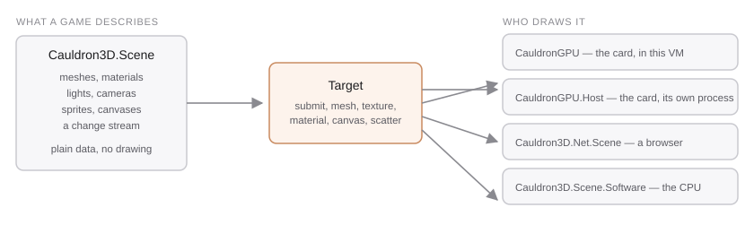

# Scenes

A scene is plain data. `cauldron_3d_scene` holds the structs a scene is made of, the
binary change stream a renderer reads, and the `Cauldron3D.Scene.Target` protocol every
renderer implements. The package needs no native code; its renderers are other packages,
except for `Cauldron3D.Scene.Software` here, which draws on the CPU when `cauldron_3d` is
in the build.




A game uploads its resources — meshes, textures, materials — and gets handles back. Each
tick it sends the target a list of changes: what moved, what appeared, what the camera
sees. The renderer keeps its own copy.

The frame is right-handed, `+y` up, the camera looking down its `-z`, with metres by
convention. A model made in map axes (x forward, y left, z up) is stood in this frame by
`Cauldron3D.Scene.Placement.transform/3`.

## Uploads, then changes

| You have | Upload through | You get |
| --- | --- | --- |
| Triangles | `Cauldron3D.Scene.Target.mesh/2` | a mesh handle |
| A picture | `Cauldron3D.Scene.Target.texture/2` | a texture handle |
| A material | `Cauldron3D.Scene.Target.material/2` | a material handle |
| Many places for one mesh | `Cauldron3D.Scene.Target.scatter/2` | a scatter handle |
| A picture to draw into | `Cauldron3D.Scene.Target.canvas/2` | a texture handle |
| Anything placed, moved or lit | `Cauldron3D.Scene.Target.submit/2` | `:ok`, or an error |

A handle is a `%Cauldron3D.Scene.Handle{}`: it names a mesh, texture, material or scatter
inside the renderer, and its `id` is the number the change stream uses. A material's
handle keeps the texture handles it uses. When a handle is no longer referenced the
renderer frees the object; `Cauldron3D.Scene.Target.release/2` asks for that sooner.

## Meshes

A `%Cauldron3D.Scene.Mesh{}` holds `vertices`, `indices` and `parts`, plus optional
`skin`, `colors` and `morphs`.

| Field | Holds |
| --- | --- |
| `vertices` | 48 bytes a vertex: position, normal, `{u, v}`, lightmap coordinates, four light styles |
| `indices` | little-endian `u32`, three per counter-clockwise triangle |
| `parts` | `{first_index, index_count}`; an instance gives one material per part |
| `skin` | 8 bytes a vertex for a skinned mesh: four bone indices and four weights |
| `colors` | RGBA a vertex, multiplying the material's base colour |
| `morphs` | up to 64 morph targets as vertex offsets |

`Cauldron3D.Scene.Mesh.new/3` builds one from vertex maps and a flat index list.
`cube/1`, `plane/2` and `sphere/2` build the three shapes a scene usually starts with;
`plane/2` lies on the XZ plane facing `+y`. `placed/2` bakes a transform into the
vertices, and `joined/1` makes one rigid mesh of several. `vertex_count/1` and
`index_count/1` read the counts back.

## Textures

A `%Cauldron3D.Scene.Texture{}` holds `width`, `height` and `pixels`, rows from the top.
`format` is `:srgb` for colour pictures, `:linear` for data such as roughness,
`:rgba16f` for four half floats a pixel, or `:r8` for one data channel (the browser
renderer only). `filter`, `wrap` and `mipmaps` say how it is sampled.

`Cauldron3D.Scene.Texture.checker/4` makes a checkerboard without a file.
`Cauldron3D.Scene.Texture.encoded/2` takes a PNG or JPEG file as it is, its size read
from the header; a browser decodes it, and the native renderer decodes it first with
`CauldronGPU.decode/1`.

```elixir
bricks = Cauldron3D.Scene.Texture.checker(64, 8, {255, 255, 255, 255}, {40, 40, 40, 255})
{:ok, photo} = Cauldron3D.Scene.Texture.encoded(File.read!("bricks.jpg"))
```

## Materials

A `%Cauldron3D.Scene.Material{}` is glTF's metallic-roughness model with the switches a
game needs. Its textures are texture handles, or `nil`.

| Field | Says |
| --- | --- |
| `base_color`, `base_texture` | the colour, and the picture that multiplies it |
| `metallic`, `roughness` | how metallic and how rough; `metallic_roughness_texture` scales both |
| `emissive`, `emissive_strength`, `emissive_texture` | light the surface gives off |
| `normal_texture`, `normal_scale` | a tangent-space normal map |
| `occlusion_texture` | darkens ambient light by its red channel |
| `lightmap`, `lightmap_scale`, `lightmap_styles` | baked light at the vertices' lightmap coordinates |
| `alpha_cutoff`, `alpha_mode` | cut-out pixels; `:opaque`, `:blend`, `:add` or `:multiply` |
| `unlit`, `double_sided`, `uv_scroll`, `uv_from` | no lighting; both faces; moving coordinates; reflection mapping |
| `sky`, `warp`, `liquid`, `smear` | a sky surface, a rippling one, standing water, or the picture behind |
| `layers`, `layer_scale` | up to four textures mixed by the vertex colours |

`Cauldron3D.Scene.Material.textures/1` lists every texture handle a material uses, which
is what a renderer keeps alive.

```elixir
red = %Cauldron3D.Scene.Material{base_color: {0.8, 0.1, 0.1, 1.0}, roughness: 0.4}
water = %Cauldron3D.Scene.Material{liquid: %Cauldron3D.Scene.Liquid{}}
```

## Instances

A `%Cauldron3D.Scene.Instance{}` places a mesh with one material per part. The last
material serves any further parts.

| Field | Says |
| --- | --- |
| `mesh`, `materials`, `transform` | what is drawn and where |
| `hidden`, `shadows`, `snap` | not drawn; keeps out of the shadow map; places without interpolating |
| `in_front` | drawn over the world, as a held weapon is |
| `depth_test` | `false` draws it over everything before it, hiding nothing |
| `standing` | floors at or below and ceilings at or above these heights do not hide it |
| `scatter`, `sway`, `fade`, `swell` | many places; bent by wind; shrinking with distance; bulging along normals |

## Lights

A `%Cauldron3D.Scene.Light{}` is `:directional`, `:point` or `:spot`. `intensity` scales
`color`; a point light reaches `range`; a spot narrows to a cone between `inner_cone` and
`outer_cone`, in radians. The first directional light with `shadows: true` casts shadows.

```elixir
sun = %Cauldron3D.Scene.Light{
  kind: :directional,
  direction: {-0.4, -1.0, -0.3},
  intensity: 3.0,
  shadows: true
}
```

## Cameras

A `%Cauldron3D.Scene.Camera{}` holds `position`, a `rotation` quaternion, `fov_y` in
radians, and `near` and `far` distances. `Cauldron3D.Scene.Quat.yaw_pitch/2` builds the
usual rotation. `snap: true` places it without interpolating from the previous tick.

`viewport` is the part of the frame the view is drawn into, as fractions from the top
left; the rest is black under the overlay. `aspect` is how wide the viewport shows
against its height, for pixels that are not square, and `resolution` draws the view as
that many blocks across and down.

## Environments

A `%Cauldron3D.Scene.Environment{}` says what surrounds the scene. A game sets the few
fields it cares about; the rest keep their defaults.

| Group | Fields |
| --- | --- |
| Sky | `sky_top`, `sky_horizon`, `sky_ground`, or `sky_picture` for two layers or a six-sided box |
| Light | `ambient`, `ambient_intensity`, `reflections`, `exposure`, `tone_map` |
| Air | `fog_color`, `fog_density` |
| Effects | `shadow_distance`, `ao_radius`, `ao_strength`, `render_scale`, `bloom_strength`, `bloom_threshold` |
| Palette games | `light_space: :display`, `gamma`, `contrast`, `brightness`, `light_table` |
| Style | `shading: :toon`, `toon_bands`, `shade_color`, `outline_width`, `wind` |

## Sprites and 2D layers

A `%Cauldron3D.Scene.Sprite{}` is a rectangle of a texture placed in a
`%Cauldron3D.Scene.SpriteLayer{}`: `source` picks the part, `position` and `origin` place
it, `scale` and `angle` turn it, `colour` and `alpha` tint it, and `mode` blends it
`:over`, `:add` or `:subtract`.

A layer draws into `:frame` or into a canvas, inside `port`, from the sprites' space
`view`. `Cauldron3D.Scene.ColumnLayer` redraws a texture column by column through a table
of positions, stretches and shades. Layers are sent with `{:layers, [...]}` and drawn
every frame until the next `{:layers, ...}`. Colours are display values, blended as
stored.

```elixir
ship = Cauldron3D.Scene.Target.texture(target, ship_texture)

Cauldron3D.Scene.Target.submit(target, [
  {:layers,
   [
     %Cauldron3D.Scene.SpriteLayer{
       view: {0, 0, 320, 200},
       sprites: [%Cauldron3D.Scene.Sprite{texture: ship, position: {160, 100}, angle: 30}]
     }
   ]}
])
```

A renderer that has never been sent a camera draws its layers alone, on black, and skips
the 3D passes.

## The change stream

Every change is a term. `Cauldron3D.Scene.Stream` lists them all and
`Cauldron3D.Scene.Stream.encode/1` turns a list into the stream a renderer reads.

| Change | Does |
| --- | --- |
| `{:mesh, id, mesh}`, `{:drop_mesh, id}` | adds a mesh, or replaces one under the same id |
| `{:texture, id, texture}`, `{:drop_texture, id}` | the same for a texture, PNG or JPEG included |
| `{:canvas, id, canvas}` | a texture the renderer draws into |
| `{:material, id, material}`, `{:drop_material, id}` | a material |
| `{:scatter, id, scatter}`, `{:drop_scatter, id}` | places an instance draws at |
| `{:instance, id, instance}`, `{:remove_instance, id}` | places a mesh |
| `{:move, id, transform}` | moves an instance, interpolated; `snap: true` to place it at once |
| `{:pose, id, pose}` | bends an instance's mesh: blend, bones or morph weights |
| `{:light, id, light}`, `{:remove_light, id}` | a light |
| `%Cauldron3D.Scene.Camera{}`, `%Cauldron3D.Scene.Environment{}` | the eye, and what surrounds it |
| `{:light_styles, styles}` | the brightness of baked light styles |
| `{:overlay, texture}`, `{:overlay, texture, :premultiplied}` | a picture over the finished frame |
| `{:screen_tint, {r, g, b, a}}` | a wash over the finished frame |
| `{:layers, layers}` | the 2D layers drawn each frame |
| `{:pushers, places}` | places that press swaying instances away |
| `{:effects, effects}` | ray tracing, upscaling or frame generation, if the renderer has it |

Each `submit` is one tick. `CauldronGPU.submit/2` and `CauldronGPU.Host.submit/2` put
`:tick` at the front, and the renderer interpolates instances, poses and the camera from
the previous tick to this one. Ids are yours, from 1 to 2³²−1; putting one again
replaces what it named.

A change list is data, so it can be kept or sent somewhere. `Cauldron3D.Scene.Host.Record`
rebuilds a scene from the changes sent to it, and answers the changes that would rebuild
it again (`Cauldron3D.Scene.Host.Record.replay/1`).

## The Target protocol

Every renderer implements `Cauldron3D.Scene.Target` for its own struct.

| Callback | Does |
| --- | --- |
| `submit/2` | takes one tick of changes |
| `mesh/2` | uploads a mesh, answers a handle |
| `texture/2` | uploads a texture, answers a handle |
| `canvas/2` | makes a canvas, answers a texture handle |
| `material/2` | defines a material, answers a handle |
| `scatter/2` | uploads places, answers a handle |
| `release/2` | frees an object once no scene entry uses it |
| `capabilities/1` | says whether the renderer has ray tracing, upscaling or frame generation |

Upload through the protocol rather than a renderer's own module when the code should
work with every renderer. The converters for game data — `Cauldron3D.Scene.Bsp`,
`Cauldron3D.Scene.AliasModel`, `Cauldron3D.Scene.StudioModel`,
`Cauldron3D.Scene.Sectors` and `Cauldron3D.Scene.Gltf` — upload through it for that
reason.

## Choosing a renderer

| Renderer | Package | Good for |
| --- | --- | --- |
| `CauldronGPU` | `cauldron_gpu` | a window on Metal or Vulkan, with ray tracing and upscaling where the device has them |
| `CauldronGPU.Host` | `cauldron_gpu` | the same, in its own OS process, so a crash leaves the game running |
| `Cauldron3D.Net.Scene` | `cauldron_3d_net` | a browser |
| `Cauldron3D.Kino` | `cauldron_3d_kino` | a Livebook cell |
| `Cauldron3D.Scene.Software` | here, with `cauldron_3d` | a machine without a usable graphics card |

`Cauldron3D.Scene.Software` draws the same scene more plainly and hands each frame to a
function of yours. It draws meshes and their materials' base colour and texture, vertex
colours, poses, `in_front` and `depth_test: false` instances, the sky's shading, ambient
light, exposure, point, spot and directional lights, the screen tint and the overlay. It
does not draw shadows, reflections, ray-traced effects, lightmaps and light styles, normal
and occlusion maps, sky pictures, fog, 2D layers, or a canvas's contents.

```elixir
parent = self()

{:ok, target} =
  Cauldron3D.Scene.Software.open(
    width: 480,
    height: 270,
    present: fn rgba, width, height -> send(parent, {:frame, rgba, width, height}) end
  )
```

Ask a renderer what it can do before offering the player an effect:
`Cauldron3D.Scene.Target.capabilities/1` answers a `%Cauldron3D.Scene.Capabilities{}`
whose `ray_tracing`, `upscaling` and `frame_generation` say what may be asked for.

## A whole scene

```elixir
alias Cauldron3D.Scene.{Camera, Instance, Light, Material, Mesh, Target, Transform}

cube = Target.mesh(target, Mesh.cube(1.0))
floor = Target.mesh(target, Mesh.plane(20.0, 4))
red = Target.material(target, %Material{base_color: {0.8, 0.1, 0.1, 1.0}, roughness: 0.4})
grey = Target.material(target, %Material{base_color: {0.5, 0.5, 0.5, 1.0}})

Target.submit(target, [
  {:instance, 1, %Instance{mesh: floor, materials: [grey]}},
  {:instance, 2,
   %Instance{mesh: cube, materials: [red], transform: Transform.new(position: {0.0, 0.5, 0.0})}},
  {:light, 1, %Light{kind: :directional, direction: {-0.4, -1.0, -0.3}, shadows: true}},
  %Camera{position: {0.0, 1.5, 4.0}}
])

Target.submit(target, [{:move, 2, Transform.new(position: {1.0, 0.5, 0.0})}])
```

## Where to go next

| You want to | Read |
| --- | --- |
| Draw this scene on the graphics card | [`cauldron_gpu`'s gpu](https://hexdocs.pm/cauldron_gpu/gpu.html) |
| Read a map, model or avatar into a scene | [`cauldron_3d_formats`' files](https://hexdocs.pm/cauldron_3d_formats/files.html) |
| Draw on the CPU without a scene | [`cauldron_3d`'s software 3D](https://hexdocs.pm/cauldron_3d/software-3d.html) |
| Put the frame in a terminal or a browser | [`cauldron_2d_drafter`](https://hexdocs.pm/cauldron_2d_drafter), [`cauldron_3d_net`](https://hexdocs.pm/cauldron_3d_net) |
