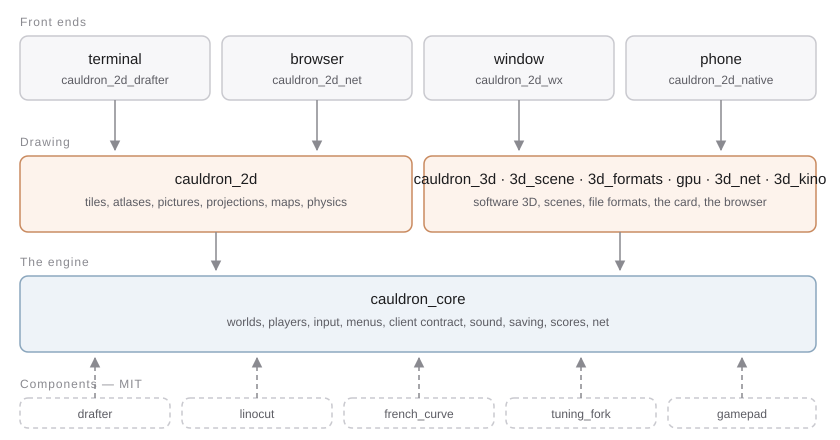

# Introduction

Cauldron is a game engine for the BEAM, written in Elixir. You write the
game once, as plain data and pure functions. Cauldron runs it for one player or many,
and puts it on a terminal, in a browser, in a desktop window, or on a phone.

The engine is split so a game pays only for what it draws with. `cauldron_core` holds
everything with no way of drawing in it. The 2D and 3D packages hold the drawing. The
front ends — terminal, browser, window, phone — are separate packages that take the
same game.

## What a game is

A Cauldron game is two modules.

**The world module** implements `Cauldron.Game`. It holds the game's state and changes
it. Its callbacks are `init/1`, `join/3`, `leave/2`, `handle_input/3`, `step/2`,
`view/2` and `drain_events/1`. Every one of them is pure: none reads a clock and none
draws. `Cauldron.World` runs the module at a fixed tick and sends each player their own
view every tick. A turn-based game starts its world with `tick: :on_input`, so the
world steps only when input arrives.

**The client module** implements `Cauldron.Client.Game`. It tells every front end how to
show the game: the title, the atlas of pictures, the actions and the keys that press
them, and the worlds a player can join. It says how a view becomes a scene and a hud,
and gives the game's sounds and music.

A front end takes the client module and runs the screens a player sees: the title, the
lobby, the settings, the world, the summary when play is over, and the guide. The same
client module works with every front end, so a game written for the terminal runs in a
browser without changing either module.

Because the world module is pure, you can test it with no process and no clock.
`Cauldron.Test` joins players, holds actions, runs ticks, and reads views and events.

## Where a game can be played

| You want | Package | Start it with |
| --- | --- | --- |
| A terminal | [`cauldron_2d_drafter`](https://hexdocs.pm/cauldron_2d_drafter) | `Drafter.run(Cauldron2D.Drafter.Client, props: %{game: MyGame.Client})` |
| A terminal over SSH or telnet | [`cauldron_2d_drafter`](https://hexdocs.pm/cauldron_2d_drafter) | `Cauldron2D.Drafter.Server.start(game: MyGame.Client, port: 2222)` |
| A browser | [`cauldron_2d_net`](https://hexdocs.pm/cauldron_2d_net) | `Cauldron2D.Net.Serve.run(MyGame.Client, argv)`, or forward a path to `Cauldron2D.Net.Pages` |
| A desktop window | [`cauldron_2d_wx`](https://hexdocs.pm/cauldron_2d_wx) | `Cauldron2D.Wx.Client.run(game: MyGame.Client, username: "alice")` |
| A phone or tablet | [`cauldron_2d_native`](https://hexdocs.pm/cauldron_2d_native) with [`cauldron_native`](https://hexdocs.pm/cauldron_native) | `mix cauldron_native.build ios --run` or `android --run` |
| A 3D game in a browser | [`cauldron_3d_net`](https://hexdocs.pm/cauldron_3d_net) | Open a `Cauldron3D.Net.Scene` and serve `Cauldron3D.Net.Page` |
| The graphics card | [`cauldron_gpu`](https://hexdocs.pm/cauldron_gpu) | Give the scene a `:gpu` function; the terminal client draws on the card when there is one |

A terminal draws pixels when it has an image protocol, and coloured glyphs from the same
atlas when it does not. A game whose scene draws its own picture chooses how that picture
reaches the terminal with the `:picture` mount prop, the `CAULDRON_PICTURE` environment
variable, or the game's `look/0`.

## The packages

| Package | Holds |
| --- | --- |
| `cauldron_core` | Worlds, players, input, menus, the shared client modules, sound, saving, scores, networking, testing |
| `cauldron_2d` | Tiles, atlases, pictures, 2D drawing, projections, maps, grids, sectors, 2D bodies |
| `cauldron_2d_drafter` | The terminal front end and its SSH server |
| `cauldron_2d_net` | The browser front end: pages, socket, channel |
| `cauldron_2d_wx` | The desktop window front end |
| `cauldron_2d_native` | The phone front end, and its build tasks |
| `cauldron_3d` | A 3D software renderer: cameras, polygons, meshes, BSP worlds, hull tracing |
| `cauldron_3d_scene` | A 3D scene as plain data, drawn by the GPU, a browser, or the CPU |
| `cauldron_3d_formats` | Quake files, glTF and VRM into `cauldron_3d` |
| `cauldron_3d_net`, `cauldron_3d_kino` | A 3D scene in a browser or a Livebook cell |
| `cauldron_gpu` | Metal and Vulkan rendering of a 3D scene |
| `cauldron_native` | iOS and Android hosts and native controls |
| `cauldron_2d_easel` | Art editing as data, with terminal, browser and Livebook editors |
| `cauldron_sfx` | A sound-effect bank and its editors |
| `cauldron_net` | Worlds on the network, whatever the game draws with |

## Where to go next

| You want to | Read |
| --- | --- |
| Add Cauldron to a project | [Installation](installation.html) |
| Understand worlds, players and ticks | [Worlds and players](worlds-and-players.html) |
| Take input and show menus | [Input and menus](input-and-menus.html) |
| Play sound and music | [Sound and music](sound-and-music.html) |
| Keep scores, settings and saves | [Saving and scores](saving-and-scores.html) |
| Test a game with no process | [Testing](testing.html) |
| Draw the game | [`cauldron_2d`'s tutorial](https://hexdocs.pm/cauldron_2d/tutorial.html) |
| Put it in a terminal | [A terminal](https://hexdocs.pm/cauldron_2d_drafter/terminal.html), [Serving over SSH and telnet](https://hexdocs.pm/cauldron_2d_drafter/serving.html) |
| Put it in a browser | [A browser](https://hexdocs.pm/cauldron_2d_net/browser.html) |
| Put it in a desktop window | [A desktop window](https://hexdocs.pm/cauldron_2d_wx/window.html) |
| Put it on a phone or tablet | [On a phone or tablet](https://hexdocs.pm/cauldron_native/overview.html), [Building a mobile app](https://hexdocs.pm/cauldron_native/building_apps.html), [Publishing a mobile app](https://hexdocs.pm/cauldron_native/publishing.html) |
| Draw it in 3D | [3D scenes](https://hexdocs.pm/cauldron_3d_scene/scenes.html), [The graphics card](https://hexdocs.pm/cauldron_gpu/gpu.html) |
| Find a word | [Glossary](glossary.html) |
| Something is not working | [Troubleshooting](troubleshooting.html) |

### Mobile and native apps

`cauldron_native` runs your release inside an iOS, tvOS, macOS or Android app. A
`cauldron_2d` game needs no phone code of its own: `cauldron_2d_native` gives it the
screen and an on-screen controller laid out as phone games lay theirs out. An app of your
own uses the platform's native controls instead.

[On a phone or tablet](https://hexdocs.pm/cauldron_native/overview.html) says what the
package offers and what a machine must have to build for each platform. The guide
[Building a mobile app](https://hexdocs.pm/cauldron_native/building_apps.html) walks from
`mix new` to a development build running on a device, with the native controls and the
app's lifecycle. [Publishing a mobile app](https://hexdocs.pm/cauldron_native/publishing.html)
takes that build to the App Store and Google Play.
