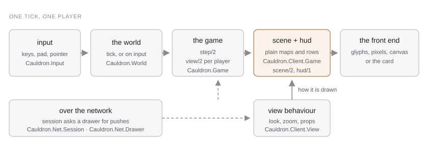

# Worlds and players

A world is a process that runs one game at a fixed tick and keeps its players supplied
with views. The game is a module implementing `Cauldron.Game`; the world is
`Cauldron.World`.




## The world module

Seven callbacks, and four more a game may add:

| Callback | Called | Returns |
| --- | --- | --- |
| `init/1` | Once, with `:game_opts` | The state |
| `join/3` | When a player joins | `{:ok, state}` or `{:error, reason}` |
| `leave/2` | When a player leaves or its process exits | The state |
| `handle_input/3` | Before a step, for each player whose input is waiting | The state |
| `step/2` | Once per step, with `dt` in seconds | The state |
| `view/2` | After a step, for each player due a frame | Anything; sent to that player |
| `drain_events/1` | After a step, once | `{events, state}` |

The optional callbacks are `export/1`, `restore/1` and `checksum/1`, for a world another
machine follows, and `input_delay/1`, for rollback. A game without them gets the
defaults the behaviour describes.

Every callback is pure: none reads a clock and none draws. A game given the same options
and the same calls in the same order runs identically, which is what makes
[testing](testing.html) and replays possible.

```elixir
defmodule Tag.Game do
  @behaviour Cauldron.Game

  @impl true
  def init(_opts), do: %{players: %{}}

  @impl true
  def join(state, id, _props) do
    {:ok, put_in(state.players[id], %{x: 0.0, held: MapSet.new()})}
  end

  @impl true
  def leave(state, id), do: %{state | players: Map.delete(state.players, id)}

  @impl true
  def handle_input(state, id, %{held: held}), do: put_in(state.players[id].held, held)

  @impl true
  def step(state, dt) do
    players =
      Map.new(state.players, fn {id, player} ->
        speed = if :right in player.held, do: 4.0, else: 0.0
        {id, %{player | x: player.x + speed * dt}}
      end)

    %{state | players: players}
  end

  @impl true
  def view(state, id), do: %{me: Map.fetch!(state.players, id)}

  @impl true
  def drain_events(state), do: {[], state}
end
```

`join/3`'s `props` are the game's to define. The front ends pass `:username` and whatever
the game's `join_props/1` adds; a game that wants teams, spectators or a character choice
names those props itself and reads them here.

## Starting a world

```elixir
{:ok, world} = Cauldron.World.start_link(game: Tag.Game, game_opts: [seed: 1], hz: 50)
```

| Option | Meaning |
| --- | --- |
| `:game` | The module implementing `Cauldron.Game`. Required |
| `:game_opts` | Passed to `init/1`. Default `[]` |
| `:state` | A state to start from instead of calling `init/1`, as `snapshot/1` returned it |
| `:hz` | Ticks a second, and the `dt` of a step. Default `50` |
| `:tick` | `:fixed`, stepping on the clock, or `:on_input`. Default `:fixed` |
| `:record` | Keep a `Cauldron.Replay` of joins, leaves and input. Default `false` |
| `:name` | A GenServer name. Default none |

`Cauldron.World.start/1` does the same without linking the world to the caller.

## The fixed tick

Each tick the world applies the input that arrived since the last one and runs the steps
that have come due. After a tick that stepped, it drains the game's events once and
sends a frame to every player whose frame is due. The next tick is timed only once the
last has run, so the world's mailbox never holds more than one tick. Input sent while a
slow tick runs is applied before the next step, however far behind the world is. Steps
more than `Cauldron.Loop`'s `:max_steps` behind are dropped, not owed.

A step is `step/2` with a constant `dt` of `1 / hz` seconds. Two steps at 50 Hz are
0.04 seconds of game time, whatever the wall clock did.

## Turn-based games

```elixir
{:ok, world} = Cauldron.World.start_link(game: Chess.Game, tick: :on_input, hz: 10)
```

A world started with `tick: :on_input` has no clock. It runs one step, with a `dt` of
`1 / hz`, each time a player's input arrives, and sends its views after it. Nothing
happens between inputs. `pause/1` does not stop a world that steps on input.

A step applies every action held in any input sent since the last step (see
`Cauldron.World.Pending`), so a key pressed and released between two steps still counts
for one step. That is what makes a quick tap on a turn-based world's key arrive at all.

## Views per player

`view/2` is called after the step, once for each player a frame is due, and only then —
a player whose frame is not due costs no view. What it returns is sent to that player:

```elixir
receive do
  {:cauldron_frame, %{tick: tick, view: view, events: events}} -> {tick, view, events}
end
```

A frame carries the events of every step since that player's last frame. How often
frames come is the player's choice:

```elixir
:ok = Cauldron.Player.join(world, :alice, %{username: "alice"}, frames: 20)
:ok = Cauldron.Player.frames(world, :alice, 60)
:ok = Cauldron.Player.frames(world, :alice, false)
```

`true`, the default, is every tick that steps. A number is at most that many frames a
second. `false` is none, for a second seat played from a process that already receives
frames as another player. A player that never gets a frame never has `view/2` called for
it.

## Joining and leaving

```elixir
:ok = Cauldron.Player.join(world, :alice, %{username: "alice"})
:ok = Cauldron.Player.input(world, :alice, %{held: MapSet.new([:right]), aim: nil})
:ok = Cauldron.Player.leave(world, :alice)
```

The player is the calling process. `{:error, :taken}` means another process already
plays as that id; any other `{:error, reason}` is the game's refusal from `join/3`.
Joining the same id from the same process again is not `{:error, :taken}`; the game's
`join/3` decides what it means.

Input is a map with at least `:held`, a `MapSet` of actions, and `:aim`, a point or
`nil`; clients may add `:strength`, `:drag`, `:options`, `:request`, `:device` and
`:keys`. `Cauldron.Player.input/3` is a cast, so it returns before the world has seen
it, and input for an id that is not present is dropped.

A player whose process exits is removed from the world that runs the game: it calls
`leave/2` and stops sending frames. `Cauldron.World.players/1` lists the ids present,
and `Cauldron.World.snapshot/1` gives the game's state.

## Events

`drain_events/1` is called once after a step and its events go to every player in that
frame. A process that is not a player can subscribe to them:

```elixir
:ok = Cauldron.World.Events.subscribe(world)

receive do
  {:cauldron_events, world, tick, events} -> {world, tick, events}
end
```

A recorder, a referee or a bot that reads the game without playing it is a subscriber,
not a player. Joins and leaves are told to subscribers of `Cauldron.World.Presence`
separately.

## Keeping up

```elixir
%{players: 2, hz: 50, steps: 501, ticks: 256, behind: 0} = Cauldron.World.stats(world)
```

`stats/1` reports the players present, the tick rate and the steps run. Over the last
256 ticks that ran a step it also reports how many there were, and the microseconds a
tick took as a mean, a 95th percentile and the longest. `behind` is how many of those
ticks had more than one step due. A tick that is routinely behind is a game doing too
much in `step/2` or `view/2`, or an `:hz` too high for the machine.

`Cauldron.World.pause/1` stops a clocked world stepping until `resume/1`. Time paused is
not owed afterwards, and input sent meanwhile is applied on resume.
`Cauldron.World.paused?/1` says which.

## Many worlds

`Cauldron.Worlds` keeps the worlds a game offers. A world is registered once, and starts
when someone uses its name:

```elixir
:ok = Cauldron.Worlds.register(:pit, game: Tag.Game, name: "The Pit", map: "pit")
:ok = Cauldron.Worlds.register(:field, game: Tag.Game, name: "The Field", hz: 30)

:ok = Cauldron.Player.join(Cauldron.Worlds.world_name(:pit), "alice", %{username: "alice"})
```

`register/2` takes the world's own options — `:game`, `:game_opts`, `:hz`, `:tick`,
`:record` — and the lobby's: `:name`, `:map`, `:note`, `:kind`, `:teams`. `list/0` is
what a lobby shows, running or not, in the shape the client's `worlds/1` returns:
`%{id, name, world, players, humans, ...}`.

`Cauldron.Worlds.start/1` starts a registered world now, `world_name/1` gives the name a
player joins, and `running/1` and `running?/1` say whether it is up.
`Cauldron.Worlds.humans/1` lists the players that are not `{:robot, n}`.
`Cauldron.Worlds.stop/1` stops a world and keeps it registered; `close/1` forgets it too.

A world that has had no human in it for a while is stopped by
`Cauldron.Worlds.Sweeper`, and starts again on the next use of its name. Its `:children`
function gives the processes that run beside it — computer players, a
`Cauldron.Ledger.Recorder` — and `Cauldron.Worlds.reseat/1` starts the ones that are
missing.

## Worlds on other machines

A world can follow another instead of running its own copy of the thinking:

```elixir
{:ok, follower} = Cauldron.World.start_link(game: Tag.Game, follow: host_world)
```

The follower has no clock. After each of the host's ticks it applies the joins, leaves
and input the host applied, and runs the steps the host ran. It then sends its own
players their frames. Only joins, leaves and input cross between the machines, never
views. With `rollback: true` the other world runs its own clock and both sides replay
late input; a host plays with rollback against one world at a time.
`follow: {:link, address, port}` reaches a world behind a `Cauldron.Link` listener
without Erlang distribution.

## Where to go next

| You want to | Read |
| --- | --- |
| Send actions and show menus | [Input and menus](input-and-menus.html) |
| Test a world with no process | [Testing](testing.html) |
| Give the world a client module | [`cauldron_2d`'s tutorial](https://hexdocs.pm/cauldron_2d/tutorial.html) |
| Find a word | [Glossary](glossary.html) |
